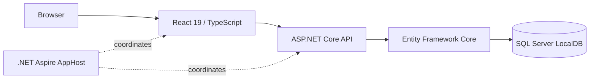

<p align="right"><strong>Language:</strong> <a href="README.md">Português (Brasil)</a> · <a href="README.en.md">English</a></p>

<p align="center"></p>
<p align="center"></p>
<h1 align="center">Hydra Digital Shop</h1>
<p align="center"><strong>Full-Stack digital storefront study using ASP.NET Core, React and .NET Aspire.</strong></p>
<p align="center">
  
  
  
  
  <a href="https://github.com/RMBarros-Dev/Hydra-Digital-Shop/actions/workflows/ci.yml"></a>
  <a href="https://github.com/RMBarros-Dev/Hydra-Digital-Shop/actions/workflows/codeql.yml"></a>
</p>

## Contents

- [01 · Context and project positioning](#01--context-and-project-positioning)
- [02 · Live demonstration and visual references](#02--live-demonstration-and-visual-references)
- [03 · Features and implementation status](#03--features-and-implementation-status)
- [04 · System architecture](#04--system-architecture)
- [05 · Technology stack](#05--technology-stack)
- [06 · Directory structure](#06--directory-structure)
- [07 · Prerequisites and installation](#07--prerequisites-and-installation)
- [08 · Environment and data configuration](#08--environment-and-data-configuration)
- [09 · User guide](#09--user-guide)
- [10 · Testing and quality](#10--testing-and-quality)
- [11 · Internationalization and localization](#11--internationalization-and-localization)
- [12 · Deployment and infrastructure](#12--deployment-and-infrastructure)
- [13 · Security and limitations](#13--security-and-limitations)
- [14 · Additional documentation](#14--additional-documentation)
- [15 · Contribution, license and credits](#15--contribution-license-and-credits)

## 01 · Context and project positioning


### Overview

Hydra Digital Shop is a Full-Stack learning project exploring integration between an ASP.NET Core API and a React/TypeScript Web interface. .NET Aspire coordinates local development components.

### Context and Purpose

The project models a digital game storefront to practice frontend/backend integration, service organization, relational persistence and local orchestration. It is an educational software project, not a commercial payment platform.

## 02 · Live demonstration and visual references

The current README does not identify a public demo URL or runtime screenshot. Use the local demonstration or the visual references identified in this section.

## 03 · Features and implementation status

The status presented here reflects the scope described in the README and the material referenced by the repository. It is not, by itself, operational sign-off or independent validation.

### Functional Scope

The repository documents a game catalogue, storefront pages, game details, a library view, cart interactions and a demonstrative checkout endpoint. Actual behavior should be checked against the current source code.

### Features and API Surface

- `GET /api/games` — retrieve the game catalogue.
- `POST /api/checkout` — demonstrative checkout endpoint.
- Storefront, library and game-detail interface pages.
- Game cards and cart drawer components.
- Cart state managed through React context.
- Local component coordination through .NET Aspire AppHost.

The checkout rejects unknown catalogue IDs and rounds monetary values to two decimal places. It does not integrate with a payment provider or move real money.

### Start the Backend Separately

```bash
dotnet run --project "Hydra Digital Shop.Server/Hydra Digital Shop.Server.csproj"
```

The server exposes the documented API routes. Confirm the actual listening address in the application output.

### Start the Frontend Separately

```bash
cd frontend
npm install
npm run dev
```

When running outside Aspire, set `VITE_API_URL` to the API base URL. The current frontend code uses `http://localhost:5000` as a fallback when the variable is not defined.

## 04 · System architecture


### Architecture



The frontend and backend can be started independently or through the AppHost, depending on the development workflow.

## 05 · Technology stack


### Technology Stack

| Layer | Technology |
|---|---|
| Backend | C#, .NET 10, ASP.NET Core |
| Persistence | Entity Framework Core, SQL Server LocalDB |
| Frontend | React 19, TypeScript, Vite |
| Styling | Tailwind CSS |
| Local orchestration | .NET Aspire |

## 06 · Directory structure


### Repository Structure

```text
Hydra-Digital-Shop/
├── Hydra Digital Shop.AppHost/
│   ├── AppHost.cs
│   └── Hydra Digital Shop.AppHost.csproj
├── Hydra Digital Shop.Server/
│   ├── Data/
│   ├── Program.cs
│   └── Hydra Digital Shop.Server.csproj
├── frontend/
│   ├── src/components/
│   ├── src/context/
│   ├── src/data/
│   ├── src/pages/
│   ├── package.json
│   └── vite.config.ts
├── assets/brand/
├── CHANGELOG.md
└── Hydra Digital Shop.slnx
```

## 07 · Prerequisites and installation


### Requirements

- .NET 10 SDK.
- Node.js `^20.19.0` or `>=22.12.0`.
- npm.
- SQL Server LocalDB for the default local configuration.
- Visual Studio with .NET Aspire support is optional.

## 08 · Environment and data configuration

This section consolidates the documented configuration and storage information. Sensitive values must be supplied by the runtime environment, never committed.

### Configuration and Data

Use environment variables for environment-specific configuration. The default server configuration uses SQL Server LocalDB. Initial database creation is documented through `EnsureCreated()`; evaluate migrations and a durable persistence strategy before any production use.

Never commit passwords, tokens or private connection strings.

## 09 · User guide


### Integrated Startup with Aspire

From the repository root:

```bash
dotnet restore "Hydra Digital Shop.slnx"
dotnet run --project "Hydra Digital Shop.AppHost/Hydra Digital Shop.AppHost.csproj"
```

Use AppHost logs to identify the local addresses assigned to each component.

## 10 · Testing and quality


### Quality and Validation

Use the repository's CI and CodeQL workflows as automated checks. Run backend build/tests and frontend install, lint and build commands according to the current project scripts. A passing workflow is evidence for the checks it actually runs, not proof of complete security or defect absence.

## 11 · Internationalization and localization

No internationalization/localization pipeline is documented in this repository. Support for languages or regional variants must not be inferred.

## 12 · Deployment and infrastructure

The current documentation does not identify a production provider or published environment. Deployment must be defined and validated before availability is claimed.

## 13 · Security and limitations


### Security

Before exposing the application publicly, review CORS, authentication, authorization, input validation, session handling and checkout security. A development configuration is not a production security baseline.

### Known Limitations

- The documented default persistence is local SQL Server LocalDB.
- The checkout endpoint is demonstrative and is not a payment-gateway integration.
- Authentication, authorization, idempotency, real payment processing and production inventory workflows remain outside the documented scope.
- Production readiness requires additional architecture, security, operational and data-persistence validation.

## 14 · Additional documentation


### Documentation and Engineering Principles

- [Visual identity guide](docs/brand/README.md).
- [Banner](assets/brand/banner.svg) and [logo](assets/brand/logo.svg).
- [Project structure](docs/project-structure.md).
- [Changelog](CHANGELOG.md).

Relevant principles include separation of responsibilities, environment-based configuration, clear API contracts, data validation, credential protection and dependency review. Documentation of a principle does not mean every control is implemented or audited.

## 15 · Contribution, license and credits

When proposing changes, describe the goal, affected files and validation performed. Prefer small, reviewable changes; include tests when behavior changes and never submit credentials, tokens or personal data.

### Development Methodology

The solution separates frontend, server and orchestration components. Prefer small, reviewable changes; validate HTTP contracts; review persistence behavior; and run the appropriate backend and frontend checks after changes.

### License and Attribution

See [LICENSE.txt](LICENSE.txt) for the repository license and applicable terms.
