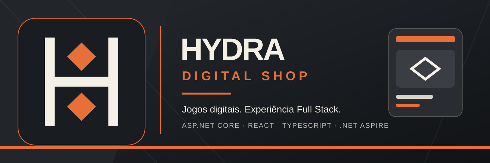
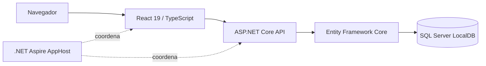

<p align="right"><strong>Idioma:</strong> <a href="README.md">Português (Brasil)</a> · <a href="README.en.md">English</a></p>

<p align="center"></p>
<p align="center"></p>
<h1 align="center">Hydra Digital Shop</h1>
<p align="center"><strong>Loja digital demonstrativa com API ASP.NET Core, React e .NET Aspire.</strong></p>
<p align="center">
  
  
  
  
  <a href="https://github.com/RMBarros-Dev/Hydra-Digital-Shop/actions/workflows/ci.yml"></a>
  <a href="https://github.com/RMBarros-Dev/Hydra-Digital-Shop/actions/workflows/codeql.yml"></a>
</p>

## Índice

- [01 · Contexto e posicionamento](#01--contexto-e-posicionamento)
- [02 · Demonstração real e referências visuais](#02--demonstracao-real-e-referencias-visuais)
- [03 · Funcionalidades e estado de implementação](#03--funcionalidades-e-estado-de-implementacao)
- [04 · Arquitetura geral](#04--arquitetura-geral)
- [05 · Stack tecnológica](#05--stack-tecnologica)
- [06 · Estrutura de diretórios](#06--estrutura-de-diretorios)
- [07 · Pré-requisitos e instalação](#07--pre-requisitos-e-instalacao)
- [08 · Configuração de ambiente e dados](#08--configuracao-de-ambiente-e-dados)
- [09 · Guia de utilização](#09--guia-de-utilizacao)
- [10 · Testes e qualidade](#10--testes-e-qualidade)
- [11 · Internacionalização e localização](#11--internacionalizacao-e-localizacao)
- [12 · Deploy e infraestrutura](#12--deploy-e-infraestrutura)
- [13 · Segurança e limitações](#13--seguranca-e-limitacoes)
- [14 · Documentação complementar](#14--documentacao-complementar)
- [15 · Contribuição, licença e créditos](#15--contribuicao-licenca-e-creditos)

## 01 · Contexto e posicionamento


### Visão geral

Hydra Digital Shop é um projeto de estudo Full Stack que explora a integração entre uma API ASP.NET Core e uma interface Web em React e TypeScript. O .NET Aspire coordena os componentes durante o desenvolvimento local.

### Contexto e objetivo

O projeto modela uma loja digital de jogos para praticar integração frontend/backend, organização de serviços, persistência relacional e orquestração local. É um projeto educacional, não uma plataforma comercial de pagamentos.

## 02 · Demonstração real e referências visuais

A documentação atual não identifica uma URL pública de demonstração. A demonstração reproduzível utiliza o ambiente local integrado pelo .NET Aspire ou a execução separada do backend e do frontend descrita no guia.

## 03 · Funcionalidades e estado de implementação

O estado apresentado nesta seção corresponde ao escopo descrito no README e no material referenciado pelo repositório. Não equivale, por si só, a uma homologação operacional ou a uma validação independente.

### Escopo funcional

O repositório documenta um catálogo de jogos, páginas de vitrine, detalhes dos jogos, visualização de biblioteca, interações de carrinho e um endpoint de checkout demonstrativo. O comportamento efetivo deve ser conferido no código-fonte atual.

### Funcionalidades documentadas

- Consulta do catálogo por `GET /api/games`.
- Endpoint demonstrativo de checkout por `POST /api/checkout`.
- Interface de loja com páginas de vitrine, biblioteca e detalhes.
- Componentes de cartões de jogos e painel lateral do carrinho.
- Estado do carrinho organizado por contexto React.
- Inicialização coordenada pelo AppHost do .NET Aspire.

O checkout rejeita identificadores ausentes no catálogo e arredonda valores monetários para duas casas decimais. Não integra um provedor de pagamento nem movimenta dinheiro real.

## 04 · Arquitetura geral


### Arquitetura



Frontend e backend podem ser iniciados separadamente ou coordenados pelo AppHost, conforme o fluxo de desenvolvimento.

## 05 · Stack tecnológica


### Tecnologias por camada

| Camada | Tecnologias |
|---|---|
| Backend | C#, .NET 10, ASP.NET Core |
| Persistência | Entity Framework Core, SQL Server LocalDB |
| Frontend | React 19, TypeScript, Vite |
| Estilização | Tailwind CSS |
| Orquestração local | .NET Aspire |

## 06 · Estrutura de diretórios


### Estrutura do repositório

```text
Hydra-Digital-Shop/
├── Hydra Digital Shop.AppHost/
│   ├── AppHost.cs
│   └── Hydra Digital Shop.AppHost.csproj
├── Hydra Digital Shop.Server/
│   ├── Data/
│   ├── Program.cs
│   └── Hydra Digital Shop.Server.csproj
├── frontend/
│   ├── src/components/
│   ├── src/context/
│   ├── src/data/
│   ├── src/pages/
│   ├── package.json
│   └── vite.config.ts
├── assets/brand/
├── CHANGELOG.md
└── Hydra Digital Shop.slnx
```

## 07 · Pré-requisitos e instalação


### Requisitos

- SDK do .NET 10.
- Node.js `^20.19.0` ou `>=22.12.0`.
- npm.
- SQL Server LocalDB para a configuração local padrão.
- Visual Studio com suporte a .NET Aspire é opcional.

## 08 · Configuração de ambiente e dados

Esta seção reúne as informações documentadas sobre configuração e armazenamento. Variáveis sensíveis devem ser fornecidas pelo ambiente de execução, nunca commitadas.

### Configuração e variáveis

Utilize variáveis de ambiente para configurações específicas de cada ambiente. Não versione senhas, tokens ou strings de conexão privadas. O servidor utiliza SQL Server LocalDB como configuração padrão de desenvolvimento.

### Persistência de dados

A criação inicial do banco está documentada por meio de `EnsureCreated()`. Antes de qualquer uso produtivo, avalie migrações, evolução de schema, persistência durável, backup e recuperação. A configuração local não demonstra uma estratégia de dados pronta para produção.

## 09 · Guia de utilização


### Inicialização integrada com Aspire

Na raiz do repositório:

```bash
dotnet restore "Hydra Digital Shop.slnx"
dotnet run --project "Hydra Digital Shop.AppHost/Hydra Digital Shop.AppHost.csproj"
```

Consulte os logs do AppHost para identificar os endereços locais atribuídos aos componentes.

### Execução do backend

```bash
dotnet run --project "Hydra Digital Shop.Server/Hydra Digital Shop.Server.csproj"
```

O servidor disponibiliza as rotas de API documentadas. Confirme o endereço de escuta na saída da aplicação.

### Execução do frontend

```bash
cd frontend
npm install
npm run dev
```

Ao executar fora do Aspire, configure `VITE_API_URL` com a URL base da API. O frontend utiliza `http://localhost:5000` como fallback quando a variável não está definida.

## 10 · Testes e qualidade


### Testes e qualidade

Utilize os workflows de CI e CodeQL como verificações automatizadas. Execute build/testes do backend e instalação, lint e build do frontend conforme os scripts disponíveis no repositório. Um workflow aprovado comprova apenas as verificações efetivamente executadas.

## 11 · Internacionalização e localização

Não há pipeline de internacionalização/localização documentado neste repositório. Não se deve inferir suporte a idiomas ou variantes regionais.

## 12 · Deploy e infraestrutura

A documentação atual não identifica um provedor ou ambiente de produção publicado. O processo de deploy precisa ser definido e validado antes de qualquer afirmação de disponibilidade.

## 13 · Segurança e limitações


### Segurança

Antes de expor a aplicação publicamente, revise CORS, autenticação, autorização, validação de entrada, gestão de sessão e segurança do checkout. A configuração de desenvolvimento não deve ser tratada como baseline de segurança de produção.

### Limitações conhecidas

- A persistência padrão documentada é SQL Server LocalDB local.
- O endpoint de checkout é demonstrativo e não integra um gateway de pagamento.
- Autenticação, autorização, idempotência, pagamento real e fluxos de estoque de produção permanecem fora do escopo documentado.
- A prontidão para produção exige validação adicional de arquitetura, segurança, operação e persistência.

## 14 · Documentação complementar


### Metodologia e documentação

A solução separa frontend, servidor e orquestração. Prefira alterações pequenas e revisáveis; valide contratos HTTP, revise o comportamento de persistência e execute as verificações adequadas de backend e frontend.

- [Identidade visual](docs/brand/README.md).
- [Banner](assets/brand/banner.svg) e [logotipo](assets/brand/logo.svg).
- [Estrutura do projeto](docs/project-structure.md).
- [Changelog](CHANGELOG.md).

Princípios relevantes: separação de responsabilidades, configuração por ambiente, contratos de API claros, validação de dados, proteção de credenciais e revisão de dependências.

## 15 · Contribuição, licença e créditos

Ao propor alterações, descreva o objetivo, os arquivos afetados e a validação realizada. Prefira mudanças pequenas e revisáveis; inclua testes quando alterar comportamento e nunca envie credenciais, tokens ou dados pessoais.

### Licença

Consulte [LICENSE.txt](LICENSE.txt) para a licença e os termos aplicáveis.
