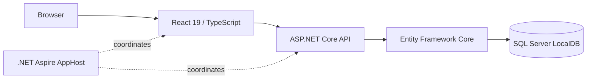

# Hydra Digital Shop

<p align="center">
  
</p>

<p align="center">
  
</p>

<p align="center">
  <strong>Loja digital de jogos com API .NET e interface React.</strong><br/>
  Uma aplicação full-stack organizada em serviços de backend, frontend e orquestração local.
</p>

<p align="center">
  <a href="https://dotnet.microsoft.com/"></a>
  <a href="https://react.dev/"></a>
  <a href="https://www.typescriptlang.org/"></a>
  <a href="https://vite.dev/"></a>
  <a href="https://learn.microsoft.com/dotnet/aspire/"></a>
</p>

---

## Índice

- [Visão geral](#visão-geral)
- [Área de aplicação](#área-de-aplicação)
- [Funcionalidades](#funcionalidades-documentadas)
- [Tecnologias e arquitetura](#arquitetura)
- [Metodologia](#metodologia-de-desenvolvimento)
- [Requisitos](#requisitos)
- [Instalação e execução](#executar-localmente)
- [Estrutura de arquivos](#estrutura-do-repositório)
- [Configuração e segurança](#configuração-e-segurança)
- [Documentação e princípios](#documentação-e-princípios-de-engenharia)
- [Limitações e licença](#limitações-conhecidas)

## Visão geral

Hydra Digital Shop é um projeto de estudo full-stack para explorar a integração entre uma API construída com ASP.NET Core e uma interface web em React e TypeScript. A solução também utiliza .NET Aspire para coordenar os componentes durante o desenvolvimento local.

O repositório está dividido em três áreas principais:

| Componente | Responsabilidade | Diretório |
| --- | --- | --- |
| API / servidor | Endpoints HTTP, lógica de servidor e acesso a dados | `Hydra Digital Shop.Server/` |
| Interface | Aplicação React, páginas e componentes de interface | `frontend/` |
| Orquestração | Inicialização coordenada dos recursos de desenvolvimento | `Hydra Digital Shop.AppHost/` |

## Área de aplicação

O projeto explora o domínio de uma loja digital de jogos, com uma interface de navegação e uma API para consulta de catálogo e operação de checkout demonstrativa. O objetivo técnico é praticar integração entre frontend, backend, persistência relacional e orquestração de serviços.

## Funcionalidades documentadas

- Consulta de jogos por meio de `GET /api/games`.
- Endpoint de checkout documentado como `POST /api/checkout`.
- Interface de loja com páginas de vitrine, biblioteca e detalhes.
- Componentes de cartões de jogos e drawer de carrinho.
- Estado de carrinho organizado em contexto React.
- Execução integrada pelo AppHost do .NET Aspire.

> Este README descreve os recursos encontrados no repositório. Não pressupõe integração com meios de pagamento ou processamento financeiro real.

## Metodologia de desenvolvimento

A solução está organizada por componentes independentes, com frontend e servidor executáveis separadamente ou coordenados pelo AppHost. A evolução deve ocorrer por mudanças pequenas e verificáveis: implementar a funcionalidade, validar contratos HTTP, revisar persistência e executar build/lint do frontend e build/testes do backend conforme a configuração disponível.

## Arquitetura



### Tecnologias por camada

| Camada | Tecnologias |
| --- | --- |
| Backend | C#, .NET 10, ASP.NET Core |
| Persistência | Entity Framework Core, SQL Server LocalDB |
| Frontend | React 19, TypeScript, Vite |
| Estilização | Tailwind CSS |
| Orquestração local | .NET Aspire |

## Requisitos

- .NET 10 SDK.
- Node.js `^20.19.0` ou `>=22.12.0`.
- npm.
- SQL Server LocalDB para a configuração local padrão.
- Visual Studio com suporte a .NET Aspire é opcional.

## Executar localmente

### Opção 1 — inicialização integrada com Aspire

Na raiz do repositório:

```bash
dotnet restore "Hydra Digital Shop.slnx"
dotnet run --project "Hydra Digital Shop.AppHost/Hydra Digital Shop.AppHost.csproj"
```

O AppHost coordena os componentes configurados para desenvolvimento.

### Opção 2 — iniciar o backend separadamente

```bash
dotnet run --project "Hydra Digital Shop.Server/Hydra Digital Shop.Server.csproj"
```

### Opção 3 — iniciar o frontend separadamente

```bash
cd frontend
npm install
npm run dev
```

Ao executar o frontend fora do Aspire, configure `VITE_API_URL` para apontar para a URL do servidor. O código utiliza `http://localhost:5000` como fallback quando a variável não está definida.

## Estrutura do repositório

```text
Hydra-Digital-Shop/
├── Hydra Digital Shop.AppHost/
│   ├── AppHost.cs
│   └── Hydra Digital Shop.AppHost.csproj
├── Hydra Digital Shop.Server/
│   ├── Data/
│   ├── Program.cs
│   └── Hydra Digital Shop.Server.csproj
├── frontend/
│   ├── src/
│   │   ├── components/
│   │   ├── context/
│   │   ├── data/
│   │   └── pages/
│   ├── package.json
│   └── vite.config.ts
├── assets/
│   └── brand/
│       ├── banner.svg
│       ├── logo.svg
│       └── project-mark.svg
├── CHANGELOG.md
└── Hydra Digital Shop.slnx
```

## Configuração e segurança

- Utilize variáveis de ambiente para configurações específicas de cada ambiente.
- Não versione senhas, tokens ou strings de conexão privadas.
- O servidor utiliza SQL Server LocalDB por padrão.
- A criação inicial do banco está documentada por meio de `EnsureCreated()`; avalie migrações e estratégia de persistência antes de qualquer uso produtivo.
- Revise CORS, autenticação, autorização, validação de entrada e segurança do checkout antes de expor a aplicação publicamente.

## Limitações conhecidas

- A configuração padrão de persistência é local, com SQL Server LocalDB.
- O endpoint de checkout documentado não deve ser interpretado como integração real com um gateway de pagamento.
- O ambiente descrito no README é voltado ao desenvolvimento; a prontidão para produção exige validação adicional.

## Documentação e princípios de engenharia

- [Identidade visual](docs/brand/README.md) — paleta e regras de aplicação.
- [Banner](assets/brand/banner.svg) e [logotipo](assets/brand/logo.svg) — ativos vetoriais.
- [Organização de arquivos](docs/project-structure.md) — responsabilidade dos principais diretórios.
- [CHANGELOG](CHANGELOG.md) — histórico de alterações disponível no repositório.

Princípios aplicáveis: separação de responsabilidades, configuração por ambiente, contratos de API claros, validação de dados, proteção de credenciais e revisão de dependências. A existência desses princípios nesta documentação não significa que todos os controles estejam implementados ou auditados.

## Licença

Consulte [LICENSE.txt](LICENSE.txt).
