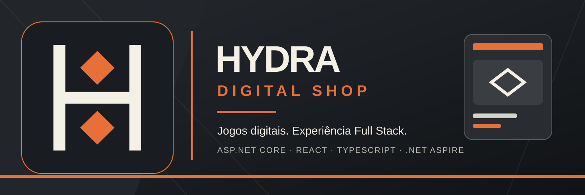
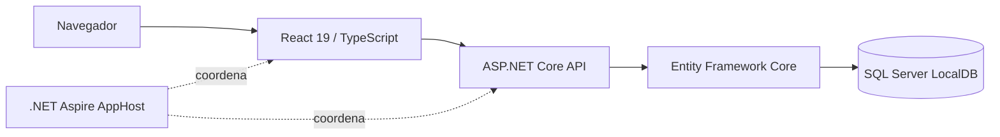
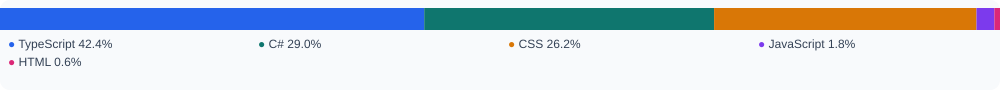

<p align="right"><strong>Idioma:</strong> <a href="README.pt-BR.md">Português (Brasil)</a> · <a href="README.md">English</a></p>

<p align="center"></p>
<p align="center"></p>
<h1 align="center">Hydra Digital Shop</h1>
<p align="center"><strong>Loja digital demonstrativa com API ASP.NET Core, React e .NET Aspire.<br>Experiência digital. Arquitetura Full Stack.</strong></p>
<p align="center">
  
  
  
  
  <a href="https://github.com/RMBarros-Dev/Hydra-Digital-Shop/actions/workflows/ci.yml"></a>
  <a href="https://github.com/RMBarros-Dev/Hydra-Digital-Shop/actions/workflows/codeql.yml"></a>
</p>

## Índice

- [01 · Visão geral](#01--visão-geral)
- [02 · Contexto e objetivo](#02--contexto-e-objetivo)
- [03 · Escopo funcional](#03--escopo-funcional)
- [04 · Funcionalidades documentadas](#04--funcionalidades-documentadas)
- [05 · Arquitetura](#05--arquitetura)
- [06 · Tecnologias por camada](#06--tecnologias-por-camada)
- [07 · Requisitos](#07--requisitos)
- [08 · Inicialização integrada com Aspire](#08--inicialização-integrada-com-aspire)
- [09 · Execução do backend](#09--execução-do-backend)
- [10 · Execução do frontend](#10--execução-do-frontend)
- [11 · Estrutura do repositório](#11--estrutura-do-repositório)
- [12 · Configuração e variáveis](#12--configuração-e-variáveis)
- [13 · Persistência de dados](#13--persistência-de-dados)
- [14 · Segurança](#14--segurança)
- [15 · Testes e qualidade](#15--testes-e-qualidade)
- [16 · Limitações conhecidas](#16--limitações-conhecidas)
- [17 · Metodologia e documentação](#17--metodologia-e-documentação)
- [18 · Licença](#18--licença)

## 01 · Visão geral

Hydra Digital Shop é um projeto de estudo Full Stack que explora a integração entre uma API ASP.NET Core e uma interface Web em React e TypeScript. O .NET Aspire coordena os componentes durante o desenvolvimento local.

## 02 · Contexto e objetivo

O projeto modela uma loja digital de jogos para praticar integração frontend/backend, organização de serviços, persistência relacional e orquestração local. É um projeto educacional, não uma plataforma comercial de pagamentos.

## 03 · Escopo funcional

O repositório documenta um catálogo de jogos, páginas de vitrine, detalhes dos jogos, visualização de biblioteca, interações de carrinho e um endpoint de checkout demonstrativo. O comportamento efetivo deve ser conferido no código-fonte atual.

## 04 · Funcionalidades documentadas

- Consulta do catálogo por `GET /api/games`.
- Endpoint demonstrativo de checkout por `POST /api/checkout`.
- Interface de loja com páginas de vitrine, biblioteca e detalhes.
- Componentes de cartões de jogos e painel lateral do carrinho.
- Estado do carrinho organizado por contexto React.
- Inicialização coordenada pelo AppHost do .NET Aspire.

O checkout rejeita identificadores ausentes no catálogo e arredonda valores monetários para duas casas decimais. Não integra um provedor de pagamento nem movimenta dinheiro real.

## 05 · Arquitetura



Frontend e backend podem ser iniciados separadamente ou coordenados pelo AppHost, conforme o fluxo de desenvolvimento.

## 06 · Tecnologias por camada

| Camada | Tecnologias |
|---|---|
| Backend | C#, .NET 10, ASP.NET Core |
| Persistência | Entity Framework Core, SQL Server LocalDB |
| Frontend | React 19, TypeScript, Vite |
| Estilização | Tailwind CSS |
| Orquestração local | .NET Aspire |

## 07 · Requisitos

- SDK do .NET 10.
- Node.js `^20.19.0` ou `>=22.12.0`.
- npm.
- SQL Server LocalDB para a configuração local padrão.
- Visual Studio com suporte a .NET Aspire é opcional.

## 08 · Inicialização integrada com Aspire

Na raiz do repositório:

```bash
dotnet restore "Hydra Digital Shop.slnx"
dotnet run --project "Hydra Digital Shop.AppHost/Hydra Digital Shop.AppHost.csproj"
```

Consulte os logs do AppHost para identificar os endereços locais atribuídos aos componentes.

## 09 · Execução do backend

```bash
dotnet run --project "Hydra Digital Shop.Server/Hydra Digital Shop.Server.csproj"
```

O servidor disponibiliza as rotas de API documentadas. Confirme o endereço de escuta na saída da aplicação.

## 10 · Execução do frontend

```bash
cd frontend
npm install
npm run dev
```

Ao executar fora do Aspire, configure `VITE_API_URL` com a URL base da API. O frontend utiliza `http://localhost:5000` como fallback quando a variável não está definida.

## 11 · Estrutura do repositório

```text
Hydra-Digital-Shop/
├── Hydra Digital Shop.AppHost/
│   ├── AppHost.cs
│   └── Hydra Digital Shop.AppHost.csproj
├── Hydra Digital Shop.Server/
│   ├── Data/
│   ├── Program.cs
│   └── Hydra Digital Shop.Server.csproj
├── frontend/
│   ├── src/components/
│   ├── src/context/
│   ├── src/data/
│   ├── src/pages/
│   ├── package.json
│   └── vite.config.ts
├── assets/brand/
├── CHANGELOG.md
└── Hydra Digital Shop.slnx
```

## 12 · Configuração e variáveis

Utilize variáveis de ambiente para configurações específicas de cada ambiente. Não versione senhas, tokens ou strings de conexão privadas. O servidor utiliza SQL Server LocalDB como configuração padrão de desenvolvimento.

## 13 · Persistência de dados

A criação inicial do banco está documentada por meio de `EnsureCreated()`. Antes de qualquer uso produtivo, avalie migrações, evolução de schema, persistência durável, backup e recuperação. A configuração local não demonstra uma estratégia de dados pronta para produção.

## 14 · Segurança

Antes de expor a aplicação publicamente, revise CORS, autenticação, autorização, validação de entrada, gestão de sessão e segurança do checkout. A configuração de desenvolvimento não deve ser tratada como baseline de segurança de produção.

## 15 · Testes e qualidade

Utilize os workflows de CI e CodeQL como verificações automatizadas. Execute build/testes do backend e instalação, lint e build do frontend conforme os scripts disponíveis no repositório. Um workflow aprovado comprova apenas as verificações efetivamente executadas.

## 16 · Limitações conhecidas

- A persistência padrão documentada é SQL Server LocalDB local.
- O endpoint de checkout é demonstrativo e não integra um gateway de pagamento.
- Autenticação, autorização, idempotência, pagamento real e fluxos de estoque de produção permanecem fora do escopo documentado.
- A prontidão para produção exige validação adicional de arquitetura, segurança, operação e persistência.

## 17 · Metodologia e documentação

A solução separa frontend, servidor e orquestração. Prefira alterações pequenas e revisáveis; valide contratos HTTP, revise o comportamento de persistência e execute as verificações adequadas de backend e frontend.

- [Identidade visual](docs/brand/README.md).
- [Banner](assets/brand/banner.svg) e [logotipo](assets/brand/logo.svg).
- [Estrutura do projeto](docs/project-structure.md).
- [Changelog](CHANGELOG.md).

Princípios relevantes: separação de responsabilidades, configuração por ambiente, contratos de API claros, validação de dados, proteção de credenciais e revisão de dependências.

## 18 · Licença

Consulte [LICENSE.txt](LICENSE.txt) para a licença e os termos aplicáveis.


## Métricas de Engenharia

<div align="center">
  
  
  
  
  
</div>

<!-- REPOSITORY_METRICS_START -->
### Distribuição de linguagens (GitHub Linguist)



| Linguagem | Bytes de código | Participação |
|---|---:|---:|
| TypeScript | 27,548 | 42.42% |
| C# | 18,824 | 28.99% |
| CSS | 17,040 | 26.24% |
| JavaScript | 1,161 | 1.79% |
| HTML | 365 | 0.56% |

_Total de bytes de código contabilizados: 64,938. Atualizado em: 2026-11-24 14:53 UTC._

<!-- REPOSITORY_METRICS_END -->

### Verificação técnica

| Dimensão | Evidência implementada | Limite da medição |
|---|---|---|
| Backend | C#, .NET 10, ASP.NET Core | Implementação da API documentada no repositório. |
| Frontend | React 19, TypeScript, Vite 8, Tailwind CSS | Aplicação frontend separada. |
| Acesso a dados | Entity Framework Core e SQL Server LocalDB | Persistência para desenvolvimento local; não é arquitetura de banco de produção. |
| Orquestração | .NET Aspire AppHost | Coordenação local de componentes, não comprovação de implantação cloud. |
| API | GET /api/games e POST /api/checkout demonstrativo | Checkout não se conecta a provedor de pagamentos. |
| CI | [Workflow de CI](.github/workflows/ci.yml) | Resultado atual indicado pelo badge acima. |
| Análise estática de segurança | [Workflow CodeQL](.github/workflows/codeql.yml) | Execução do workflow não equivale a certificação de segurança. |
| Cobertura de testes automatizados | A documentação atual não informa percentual de cobertura | Não inferido a partir do status de CI. |
