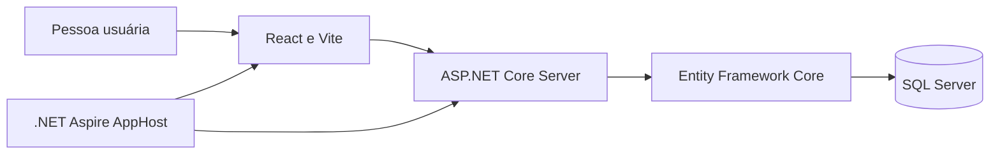

# Arquitetura do Hydra Digital Shop

## Visão geral

Mantenho o Hydra Digital Shop como uma aplicação de estudo full-stack. Separo a interface React/Vite do backend ASP.NET Core e utilizo o .NET Aspire AppHost para coordenar a execução local dos componentes.

## Componentes observados no código

| Componente | Responsabilidade |
|---|---|
| `frontend/` | Interface React/TypeScript executada com Vite |
| `Hydra Digital Shop.Server` | Endpoints HTTP, regras de checkout, acesso aos dados e OpenAPI |
| `Hydra Digital Shop.AppHost` | Orquestração do backend e do frontend por meio do Aspire |
| `AppDbContext` | Persistência de jogos e pedidos via Entity Framework Core |
| SQL Server | Banco relacional configurado pela connection string `DefaultConnection` |

## Fluxo de execução



## Decisões e limites observados

- O AppHost registra o servidor e o frontend Vite e aguarda o backend ficar disponível.
- O backend configura Entity Framework Core com SQL Server.
- O cache distribuído atualmente usa implementação em memória; o AppHost não registra Redis ativo no arquivo atual.
- O endpoint de checkout cria pedidos e chaves de ativação no banco. Não encontrei integração com gateway de pagamento no fluxo examinado; portanto, não apresento o checkout como pagamento real.
- O backend chama `EnsureCreated()` durante a inicialização. Antes de evoluir o esquema em produção, preciso avaliar uma estratégia de migrations e preservar os dados existentes.

## Verificações

Utilizo o workflow de CI para restaurar e compilar a solução .NET e executar lint/build do frontend. Também executo a suíte de testes de cálculo de checkout:

```bash
dotnet test "Hydra Digital Shop.Server.Tests/Hydra Digital Shop.Server.Tests.csproj" --configuration Release
```

## Referências

- [README](../../README.md)
- [Diretrizes de identidade visual](../brand/README.md)
- [Registro de decisões](../decisions/0001-current-architecture.md)
